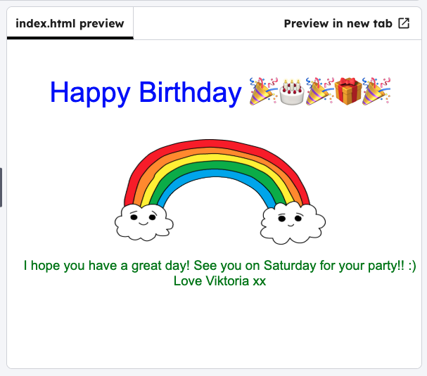

## Birthday message

Add your own `birthday-greeting` by replacing the code with your own text.

```html filename="index.html" line_numbers="true" line_number_start="11" line_highlights="12"
      <p id="birthday-greeting">
        Happy Birthday 🎉🎂🎉🎁🎉
      </p>
```

## Now run your code

Click **Run**, then click the button on the front of the card, and check that your new text appears.



> [!TIP]
> A tag is the label that shows what type of media it is. The `<p>` tag is short for **paragraph**, and `` is short for **image**.
