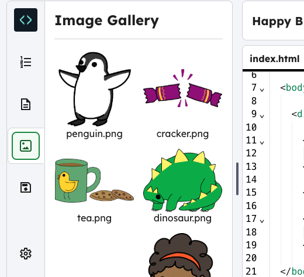
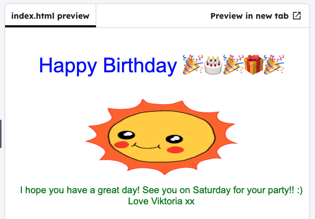

## Change the image

Edit the HTML code for the image.

## Step 1

Replace the word `rainbow` with `sun` to change the picture.

> [!TIP]
> You can see all the images by clicking on the **image gallery** icon.
>
> 

## Step 2

Add the code below, and experiment with other images. For example, try `boy`, `rainbow`, `robot`, `present`, or `snowman`.

```html filename="index.html" line_numbers="true" line_number_start="11" line_highlights="15"
      <p id="birthday-greeting">
        Happy Birthday 🎉🎂🎉🎁🎉
      </p>
      
      
```

> [!TIP]
> `pic` is an **id**, a name you give to an HTML element so that you can style it in CSS.

## Now run your code

Click **Run** and check that the picture on the card changes.


