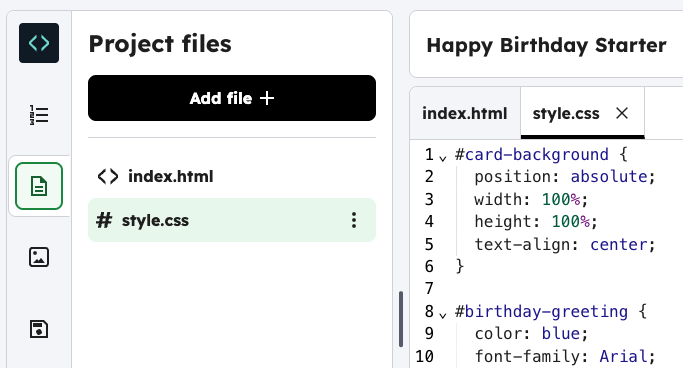
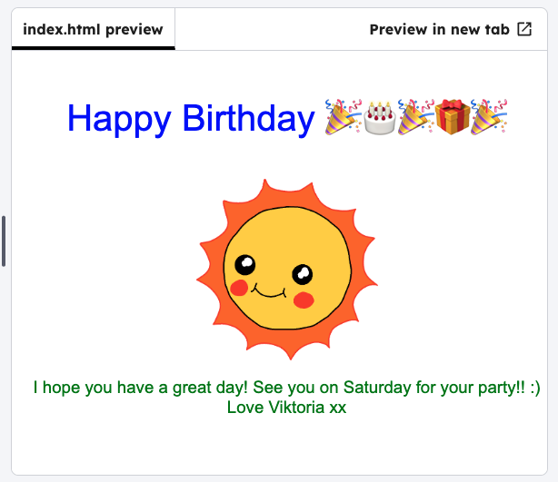

## Resize images

Change the size of the image with **CSS** code.

## Step 1

Click on the file icon and select the `style.css` file.



## Step 2

Go to the `#pic` id in the CSS code. Change the `width` and `height` of the outside image to `200px`.

```css filename="style.css" line_numbers="true" line_number_start="15" line_highlights="16-17"
#pic {
  width: 200px;
  height: 200px;
}
```

> [!TIP]
> `px` stands for pixels, which is the small squares that make up digital images.

## Now run your code

Click **Run** and check that the image appears at the new size.


