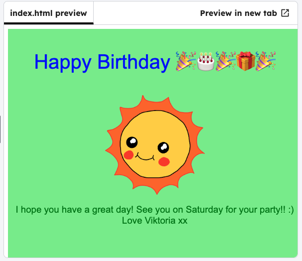

## Background colours

Experiment with colours for the background.

In the CSS file, change the `background-color` to `lightgreen`.

```css filename="style.css" line_numbers="true" line_number_start="1" line_highlights="3"
#card-background {
  position: absolute;
  background-color: lightgreen;  
  width: 100%;
  height: 100%;
  text-align: center;
}
```

> [!TIP]
> You can find more CSS colour names [here](http://jumpto.cc/colours){:target="_blank"}.

## Now run your code

Click **Run** and check that the card background colour changes.


