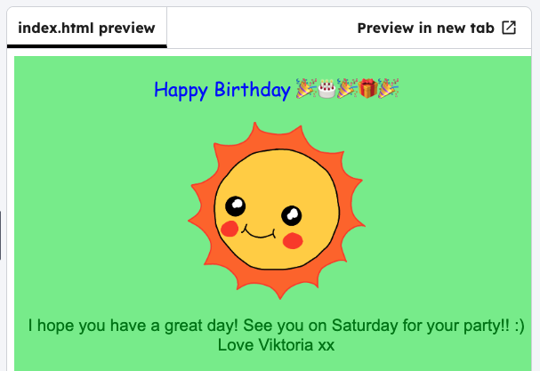

## Font style

Style the text with a different font and size.

## Step 1

Change the `font-family` to `Comic Sans MS`.

## Step 2

You can make the font bigger by changing the `font-size` to `16pt`.

```css filename="style.css" line_numbers="true" line_number_start="8" line_highlights="10-11"
#birthday-greeting {
  color: black;
  font-family: Comic Sans MS;
  font-size: 16pt;
  text-align: center;
}
```

> [!CHALLENGE]
> Try adding other fonts, for example: `arial`, `impact`, or `tahoma`.

## Now run your code

Click **Run** and check that the font on the card changes.


